```{r setup, include = FALSE}
library("papaja")
r_refs("r-references.bib")
library(dplyr)
library(stringr)
library(tidyverse)

# header-includes:
#   - \usepackage{longtable}
#   - \usepackage{graphicx}
#   - \usepackage{array}
#   - \usepackage{booktabs}
#   - \usepackage[export]{adjustbox}
```

# Declarations

## Acknowledgements

We are thankful to Sophia Wallot, Anna Lena Ibrom, Caroline Wanjiru and Yağız İpekçi for the recording of the stimuli. We are also very thankful to Natalia Gagarina, Paula Rubio Fernandez, Marisa Casillas and Giulia Bencini for useful discussions on the items of the battery.

## Funding

Manuel Bohn was supported by a Jacobs Foundation Research Fellowship (2022-1484-00). Chiara Carraro and Manuel Bohn were funded by a Lower Saxony Impulse Professorship awarded to Manuel Bohn through the zukunft.niedersachsen program.

## Conflicts of Interest

The authors declare no conflict of interest.

## Ethics approval

The study obtained ethical clearance from the Max Planck Society Ethics Commission through an umbrella ethics application (Appl. No. 2021_45), and from the Koç University Institutional Review Board.

## Material, data and code availability

The data and code necessary to reproduce the analyses presented here are publicly accessible at the link: <https://github.com/ChiaraCarraro/analysis-prabat>. A demo version of the battery is available at the link: <https://devpsy.web.leuphana.de/prabat/>.

# Introduction

Pragmatics is an integral aspect of language use and learning. A tentative definition of pragmatics is the study of language use in context [@bates1976]. However, different definitions of pragmatics and pragmatic abilities have been formulated, with consequences on the scope of the field, i.e. the range of phenomena that can be classified as pragmatic. The first theories of pragmatics such as the Gricean Cooperative Principle [@grice1975] and Sperber and Wilson’s Relevance Theory [-@sperber1986], adopted a cognitive approach that conceptualized pragmatic processes as inferential processes that integrate literal meaning with information from the context, the speaker and the world. Later accounts put more emphasis on the prominent social cognition component of pragmatics, thus seeing pragmatic inferences as social inferences, where Theory of Mind (ToM, or mentalizing), joint attention and perspective taking play a crucial role [@sperber2002; @oneill2012]. The extent to which pragmatics represents a submodule of, partially or totally overlaps with ToM is subject of debate. On the one hand, numerous approaches propose different reconfigurations of pragmatic abilities in relation to social cognition [for some examples, see @andrés-roqueta2017; @andrés-roqueta2020; @oneill2012; @domaneschi2020; @marocchini2022; @rubio-fernandez2024]. On the other hand, more recent approaches, like the Rational Speech Act framework [@degen2023], propose a formalization of the traditional conversation principles, thereby operationalizing pragmatic processes as probabilistic, rational inferential processes. Despite the flourishing theoretical work, there is no agreed-upon definition of what pragmatics is and which phenomena it encompasses. This entails a “phenomenological diversity” that makes it difficult to establish whether all phenomena classified as “pragmatic” by different traditions - from implicature, metaphor, irony comprehension to communicative gesture, prosody, turn-taking and politeness understanding - actually draw on the same cognitive resources and represent a single, unified construct [@floyd2025; @matthews2018; @russell2008].

However, the theoretical debates have not hindered empirical research. Pragmatic abilities – differentially conceptualized – have not only been found to be related to perspective taking, false-belief understanding, vocabulary, grammar, working memory, and inhibitory control [@bambini2021; see @matthews2018 for a review] but also mental health [@law2015; @brenne2019; see @dall2022 for a thorough review of links between social communicative difficulties and mental health], peer popularity [@law2014; @law2015; @mok2014; @gottman1975; @kemple1992], group membership, child prosocial behaviour [@conti-ramsden2019], social, emotional and behavioural difficulties [@helland2014; @murphy2014; @stclair2011], depressive symptoms in late adolescence [@sullivan2016; @sullivan2017], relationship formation [@whitehouse2009], and employability [@eaves2008; @lewis2008].

While the clear presence of a link between pragmatics and other domains - first and foremost language, social cognition, executive functions - underscores the importance of this ability for human development and wellbeing, there is a scarcity of psychometrically valid, reliable, individual differences assessment tools for pragmatic abilities [@matthews2018]. Especially for such a complex set of skills like pragmatics, being able to track individual differences is crucial in order to understand its development and identify what determines pragmatic development, its variation and how this variation can in turn affect the development of other cognitive and social abilities [@matthews2018].

In order to build universal theories about development, it is important to have a data base that represents the diversity of human experience beyond traditionally overstudied populations from the Global North. This aspect is particularly relevant when it comes to pragmatics, a set of skills that is tightly connected to culturally variable factors such as language and social norms [@levinson1983]. Individual-differences level research can help achieve this goal [@levinson2012]: it allows to verify whether the relationship between two variables (e.g., a cognitive trait and a specific aspect of experience, or the development of two different abilities) holds consistently both within and across multiple cultural groups [@bohn2024g]. The cross-cultural applicability is largely neglected in assessment tools for pragmatic abilities.

Even though a multitude of pragmatic assessment tools exist, there is a need for comprehensive measures of individual differences, in particular for young children [@matthews2018]. A large portion of assessment tools were designed with a diagnostic/screening goal for a broad range of populations: from adults to children, from populations with developmental language disorders [CSBS-DP, @wetherby2002; ESCS, @mundy2003][^1], autism spectrum disorder [Pragma, @loukusa2017; CCC-2, @bishop2006; YiPP, @simmons2014; SEE, @wiig2008; ADOS, @lord2000], neurodevelopmental disorders [PleaseApp, @andrés-roqueta2024], attention [POM, @cordier2014; SEE, @wiig2008] and social-pragmatics deficits [CCC-2, @bishop2006; LUI, @oneill2007; PLSI, @gilliam2006] to brain injuries, neuropsychological and psychiatric disorders [ABaCo, @sacco2008; APACS, @arcara2016]. Most of the tests for children rely on a narrative structure and/or meta-cognitive approaches, by requiring children to either respond to or explain specific types of statements or stimuli [TOPL-2, @phelps-terasakid.2007; CASL, @carrow-woolfolke.2017; Pragma, @loukusa2017; ELI, @saborit2005; APT, @pronina2019]. Alternatively, indirect measures such as checklists and questionnaires are used, where parents, clinicians, or experts answer questions based on previous observations of the child (@girolametto1997; CCC-2, @bishop2006; LUI, @oneill2007; CELF-5, @wiig2014; PLSI, @gilliam2006; SLDT-E, @bowers2008; CSBS-DP, @wetherby2002; PP, @prutting1987; POM, @cordier2014; APLSC, @hyter2012, @hyter2017; SICS, @rice1990; PLOS, @newcomer2009). Other instruments include either semi-structured interviews between the clinician and the child, or observations of unstructured interactions between the child and peers or adults during, e.g., play and school contexts, in some cases via time-sampling techniques (ESCS, @mundy2003; TOPICCAL, @adams2011; CADeT, @johnston1990; SOCI, @damico1985, @damico1999; PPECSC, @dewart1995; SICS, @rice1990; CSBS-DP, @wetherby2002; APLSC, @hyter2012; @hyter2017). Most of these tests show good psychometric qualities [@matthews2018; @hyter2017]. However, while they rely on different features to ensure an accurate, valid, and reliable assessment of pragmatic abilities, they also present multiple disadvantages. As the observation of undisturbed interactions may provide the most naturalistic setting to assess a child’s pragmatic abilities, this method requires, most of the time, highly trained personnel to conduct the assessment and is considerably time-consuming [not only for the time of the assessment, ranging from 20 [POM, @cordier2014] to 30 minutes [CSBS-DP, @wetherby2002; PP, @prutting1987], but also for the scoring itself, which can last up to 60-75 minutes in the case of the CSBS-DP]. This problem is partially overcome by tasks that require children to respond to verbal prompts and reason about scenarios and conversations [Pragma, @loukusa2017; CASL, @carrow-woolfolke.2017; TOPL-2, @phelps-terasakid.2007]. These instruments usually take less time and minimize the scoring difficulty. However, they still require considerable control of attention, memory, and meta-cognitive skills that younger children may not have. Checklists and questionnaires completed by adult caregivers, in turn, eliminate this problem and allow to gain information about younger samples [@oneill2007; @bishop2006], which would be hardly testable with tools requiring elaborate responses to verbal prompts. At the same time, by involving adults they sacrifice direct assessment of the child’s pragmatic abilities - and thus, ecological validity [@oneill2014]. Moreover, it is often difficult to determine who is the “most informed respondent”: first, because, as children start going to school, neither parents nor teachers may be able to give the full picture of the child’s communicative ability [@oneill2014]; second, because there is considerable cross-cultural variation in how many people are involved in the upbringing of a child [e.g., in Kenya, the rearing of the children involves extended family members as well, @oburu2024].

[^1]: For readability reasons, we only report the acronym of each task, when available; for a legend about each acronym, see Appendix A.

To our knowledge, there is only one example of a digital assessment tool that children can complete by themselves, namely the PleaseApp [@andrés-roqueta2024]. The PleaseApp instrument is a game application where 5- to 11-year-old children go through multiple scenarios, each involving the evaluation of different aspects of receptive pragmatic abilities, such as understanding of figurative language, narrative, referential expressions, indirect speech acts, humor, gesture-speech integration and politeness. The presence of text and the complexity of the tasks, however, makes the test not suitable for younger children. Nonetheless, as the authors underline, digital assessment tools offer a great opportunity to control for contextual factors, fundamental in pragmatic abilities’ assessment, and can be administered both online and in person, increasing the probability to reach the desired sample size [the lack of which is often a problem when doing correlational research, @matthews2018]. Moreover, the combination of visual and auditory stimulus presentation allows to simulate communicative contexts that would otherwise be difficult to recreate [@andrés-roqueta2024].

In this paper, we present the development of a psychometrically reliable and valid, easily-administrable tool that can assess individual differences in different pragmatic abilities in multiple cultural settings and languages in the preschool age (i.e., 3- to 6-year-old children). For its development we took the following steps. First, we created a large pool of items assessing a broad range of pragmatic abilities. In order to establish precise criteria about which items to include, we specified a working definition of pragmatic phenomena based on previous literature [@sperber1986; @grice1975; @oneill2012]. For our purpose, an item requires pragmatic reasoning to be solved when: 1) the item contains either a literal linguistic or paralinguistic message that is not sufficient in order to comprehend the intended meaning of the utterance; 2) to be correctly interpreted, the literal linguistic or paralinguistic message needs to be integrated with information either about the interlocutor, about the world, or about the context (see Appendix B for a list of items and how each one reflects these criteria)[^2]. In order for the instrument to be objective and brief, we developed it as a digital application that could be administered both in person and online. This not only ensures to consistency of variables such as conversational context and intonation, but also allows for easy administration - not requiring specialized personnel such as clinicians and speech therapists - and therefore facilitates achieving larger sample sizes. Because modern technologies do not (yet) allow for immediate and accurate transcription of audio (production) data, we focused on the assessment of receptive pragmatic abilities, a still understudied domain of pragmatics [@andrés-roqueta2024]. Because we wanted our test battery to be cross-culturally adaptable, we only included items that could be easily adapted to multiple cultures in a comparable way. To ensure that, we consulted with native speakers from Kenya, Türkiye, and Germany, and only included items that were judged appropriate across these three – culturally and linguistically distinct – contexts. For example, irony and sarcasm comprehension were left out, as the adaptation of such an item would require substantial changes to the task depending on the culture with little certainty about its cross-cultural comparability. We then used Item Response (IRT) models to select the best-performing items from the initial pool to ensure that items measure the same latent ability. More precisely, we aimed for the battery to conform to a 1-parameter logistic (1PL; Rasch) model, so that the sum score can be used as a score for performance [@rasch1960]. Although factorial work is much needed to investigate the potential heterogeneous nature of pragmatics [@floyd2025], IRT is well suited for test construction, as it allows to build item sets by looking at the probability to solve an item as a function of the underlying ability and item-level estimates. Whereas other latent-variable approaches as, e.g., exploratory factor analysis (EFA) investigate how many latent dimensions account for shared variance between items, our goal was not to identify the different dimensions characterizing pragmatics; Rather, we aimed at building a battery consisting of items that function well along a common pragmatic-ability continuum and that allowed us to distinguish with precision individuals with different pragmatic ability levels. Additionally, we aimed for a final battery that contained items that not only best measure the latent pragmatic ability, but that can also capture individual differences. In order to achieve both these goals, we used a semi-automated selection procedure to find a subset of items that both conformed to a Rasch model and contained items spread across the latent ability scale. Finally, in order to ensure the psychometric quality of the instrument, we looked at differential item functioning, and assessed the test - retest reliability and convergent validity.

[^2]: It is important to note that our goal here is not to give a definition of pragmatic ability, but rather to define operationalizable and concrete criteria that help us in defining what should be included as pragmatic phenomena.

In the following sections, we report the construction, psychometric evaluation, and cross-cultural adaptation of this measurement tool, which we call PraBat (Pragmatics test Battery). 

# The current study

## Item-pool generation

In the initial item pool, we aimed at including items assessing as broad a range of pragmatic abilities as possible. However, in order to obtain a battery characterized by a simple administration procedure and easy cross-cultural adaptability, items had to meet specific criteria: they had to be implementable in a picture selection paradigm, to avoid a narrative task structure, and effortful scoring procedure; items therefore had to assess a receptive pragmatic ability, as the paradigm did not allow to test for expressive abilities; items should not require culture or language specific background knowledge (see Cultural adaptation section for details); and they had to target pragmatic abilities developing between 3 and 6 years of age. Following these criteria, we created a total of 27 critical items measuring the following pragmatic abilities: figurative thinking, ad-hoc, typicality, conversational and scalar implicature understanding, mutual exclusivity, indirect request understanding via gaze cue integration, discourse-based inferences, communicative gesture comprehension, conversational perspective taking, emotional prosody understanding. The items are mostly based on tasks and constructs already present in the literature; when not, it is explicitly mentioned (see Appendix B for a list of all initial items, with references to the literature each item is based on).

## Task design and implementation

The test battery was implemented as an interactive picture book in HTML, CSS and JavaScript. It was programmed as a Progressive Web App and can thus be run online as a website in any browser but can also be downloaded and run offline if needed.

In the battery, children interact with a cartoon character, Ella. The battery begins with a short sequence of images where Ella introduces herself, her family, and friends. This introduction is thought to engage children and familiarize them with the character. At the end of the introduction, Ella asks the participant to play with her, and after pressing on ‘continue’ the test battery starts. In all trials, children are asked to click on one of three options (Figure \@ref(fig:intro).A shows an example trial, Mutual Exclusivity in nouns). The first three trials are familiarization trials, where children are asked to click on an object among three familiar ones, in order to get acquainted with the procedure. In the discourse-based inference items, a sequence of short scenes are presented to provide the conversational context for the critical prompt (i.e. Ella’s request), while the Discourse Continuity item consists of five exposure trials and one critical trial (see Appendix B for a more detailed description of the items). A response can be given only once the audio prompt has finished playing. As per instruction, children are guided through the task by an adult native speaker (caregiver or experimenter). The adult is instructed to click on the ‘continue’ button to proceed with the next trial after their child has given a response. In case the child asks for it, the caregiver (or experimenter) can also replay a trial by clicking on the audio symbol, visible next to the continue button. When administered on a tablet with a touch screen, children respond by touching a picture on the screen. When no touchscreen is available (e.g., in case of online data collection - see below) children are instructed to point to the screen and the adult should then select the pointed-to-picture (via mouse click). Test sessions can be recorded using the webcam if needed. The correct response appears almost equally in each of the three positions (12 times on the left, 11 times in the center, 12 times on the right). Together with familiarization and exposure trials, the full test battery comprises 35 trials. Once the battery is completed, a .CSV with the child's responses and a video file from the webcam are downloaded.

## Item selection

The goal of the item selection process was to find a subset of items of varying difficulty that conform to the Rasch model and induce sufficient variability. We collected a large dataset from children from a broader age range, we extracted item-level fit statistics and parameters and used a semi-automated item selection procedure to identify the best subset of items [see also @bohn2023i; @bohn2024h]. After selecting the best subset of items, we investigated differential item functioning (DIF) to ensure items were not biased by other variables (e.g., sex). All IRT models were implemented in a Bayesian framework in R using the brms package [@bürkner2017; @bürkner2021], except explicitly mentioned cases.

### Participants

In total, 713 children (354 girls, 2 diverse, mean age= 5.60, range: 2.63-8.06; 681 from Leipzig, 32 from Lüneburg) completed the battery. The data for the item selection analysis was collected between December 2025 and February 2026 via a database of children living in Lüneburg and Leipzig, Germany. Leipzig is an industrialized, urban Central European city with approximately 600,000 inhabitants. The city-wide average household monthly disposable income in 2021 was \~ €2030 [@einkomme]. Lüneburg is a middle-sized, urban city of 77.000 inhabitants, with an average household monthly disposable income in 2021 of **\~** €1990 [@einkomme]***.*** Socioeconomic status was not formally recorded, although the majority of families have a mid to high socioeconomic background, with high levels of parental education. Moreover, the sample was probably skewed towards highly motivated and interested families. 2600 emails were sent to parents of children between 2 and 8 years of age, who gave consent for their children to participate in online studies on child development. The email contained a short study description and a personalized link. A reminder was sent to parents if they had not already taken part in the study approximately one month after they received the first email. The sample size was determined based on recommendations found in the literature and on previous examples of instruments developed with the same procedure [@bohn2023i; @bohn2024h; @morizot2007].

Figure \@ref(fig:intro).B shows the age distribution and accuracy scores of the sample by age.

```{r intro, include = T, echo=FALSE, cache=FALSE, out.width="100%", fig.cap="A. Example of a battery's item. In this Mutual Exclusivity (Noun) item, Ella asks: 'Look, there's a palvi. Can you click on the palvi?'. B. Predicted developmental trajectory based on a GLMM model of the sample's accuracy on the 27 items. Black points show age group means (with 95% CI based on non-parametric bootstrap). Light dots show the proportion of correct answers for each subject. The dotted line shows the level of performance expected by chance."}
library(cowplot)
p1 <- ggdraw() + draw_image("../figures/figure_1a.png")
p2 <- ggdraw() + draw_image("../figures/figure_1b.png")

fig1 <- plot_grid(
  p1, p2,
  nrow = 1,                     # force horizontal layout
  labels = c("A", "B"),
  label_size = 22,
  # # label_fontface = "bold",
  label_x = -0.01,
  label_y = 1
)

ggsave(
  "../figures/fig1.png",
  plot = fig1,
  width = 14,
  height = 5,
  units = "in",
  dpi = 300
)

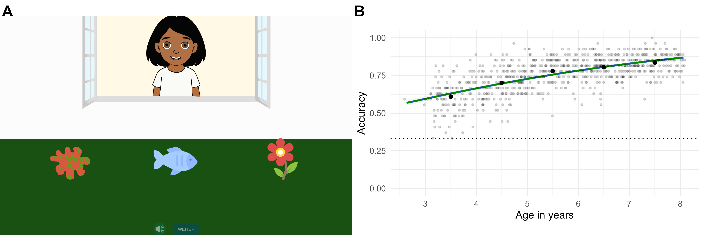
```

### Step 1. Item response modeling

IRT models describe the probability to solve an item with a logistic function that takes into account the person’s ability level and specific item parameters. This function is best represented by Item Characteristic Curves, which show the probability to solve an item given a specific ability level. ICCs can also be used to visually inspect the parameter estimates of different items not only in relation to one another, but also in relation to the latent ability in question. For example, an item’s curve position along the x axis is determined by its difficulty, while an item’s curve steepness is determined by how precisely that item discriminates between individuals with different ability levels, i.e. the item’s discrimination: a highly discriminating item differentiates more strongly between individuals with slightly different ability levels around the item’s difficulty, resulting in a steeper ICC. In contrast, an item with low discrimination differentiates less strongly between individuals with different ability levels, resulting in a flatter slope. While 2PL models allow items to vary both in their discrimination and difficulty parameters (ICCs would therefore vary both in position in the x axis and slope), Rasch models only allow for the difficulty parameter to vary, but assume all items to have the same discrimination parameter (with items only varying in their position on the x axis, but exhibiting the same slope, as in Figure \@ref(fig:ICC-1PL)). The sum score can be used as a sufficient test score only if the items conform to the Rasch model: across the entire latent ability, the model assumes that the probability to solve an easier item will never be lower than the probability to solve a more difficult item. This assumption does not hold in the case of 2PL models. 2PL models would therefore need the test results to be fit into the model in order to estimate the person’s ability level, thus requiring norming data and a scoring model. A Rasch compliant battery is therefore a better solution for easy and immediate scoring.

For each item, we quantified its fit to the Rasch model in the following way: first, we extracted item fit statistics, i.e. Infit and Outfit. These statistics indicate the fit of the individual items to the model. While Infit focuses on the model’s performance when the person’s ability level is at the item’s target difficulty level, the Outfit describes the model’s performance when the person’s ability level is far from the item’s target difficulty level, thus being more sensitive to outliers. These statistics are calculated for each item and should have a value between 0.7 and 1.3 [@wright1994a].

Second, we extracted the discrimination parameters for each item from the 2PL model. In order to build a battery containing items that well fit a Rasch model, it is necessary for the main assumptions to be satisfied. Items with very similar discrimination parameters are items that together will give a better Rasch model fit.

Lastly, in order to have a battery that allows us to look at individual differences, a sufficient number of items covering a wide range of the target latent ability are necessary. From the Rasch model, we extracted easiness (inverse of difficulty) parameters, as to know how items are distributed along the latent ability scale.

### Step 2. Automated selection process

The next step was to use the statistics we extracted and use them to determine the best subset of items. To do that, we formulated an objective function that would calculate a score for each subset of items based on the infit, outfit, easiness, and discrimination parameters of the contained items. The objective function’s purpose was to penalize subsets that did not reflect the following criteria: contained Rasch compliant items; contained items equally spread across the latent ability scale; contained items that had similar discrimination parameters.

These requirements were quantified in the following way. The score for easiness spacing was calculated as the standard deviation of the distance between difficulty estimates of adjacent estimates. Items were sorted by difficulty, and the distance was calculated as the difference between difficulty estimates of adjacent items. A lower score indicated a lower standard deviation of the difficulty spacing between items, namely closer-to-equal easiness spacing between the subset’s items. This score was then divided by three to bring it to a scale comparable to the other components. To score Infit and Outfit, we calculated the average of the distance of each item’s fit value from 1. This average was then multiplied by -4 in the case of Infit and -2 in the case of Outfit. More weight was therefore given to bad Infit values. Lastly, the discrimination score was determined as the variance of the subset items’ discrimination parameters multiplied by -6. These four scores were summed together resulting in an always negative total score. More negative values therefore indicated a lower, i.e. worse score.

The objective function’s score would then be used inside a simulated annealing (SA) algorithm [@kirkpatrick1983]. The SA algorithm is a probabilistic optimization procedure that, in our case, returns the best item combination for each subset size. For each subset size considered, the algorithm does the following: it starts from a randomly determined subset of items; randomly substitutes items of that subset; if the objective function returns a better value than before, the newly proposed subset becomes the starting point for the successive proposals. A “temperature” parameter influences the probability of the algorithm to accept a specific proposal. In the initial “hot” phase, where the temperature parameter is high, the process accepts more often proposals that decrease the objective function’s score, preventing the algorithm from getting stuck in local optima (best subset within a neighboring set of choices) and facilitating the discovery of global optima (best subsets overall). As the temperature decreases, the probability of accepting lower scored subsets decreases, favoring the acceptance of better proposals. This allows for the refinement of the best subset found during the hot phase. Because we did not want to have a battery containing less than 18 items (as to cover the latent ability range with enough precision) and because we already knew at least two to three items had very bad parameters and/or fit, we let the SA algorithm iterate over 18- to 23-item subset sizes.

Once the simulated annealing algorithm identified the best subset for each subset size, we assessed whether the Rasch model provides an acceptable fit both in absolute terms and relative to a 2PL model. Consequently, for each subset we calculated several model fit indices [Comparative Fit Index (CFI), Root Mean Square Error of Approximation (RMSEA) and Standardized Root Mean Square Residual (SRMSR)]. We then compared the Rasch and 2PL models fits using Bayesian approximate leave-one-out cross validation [@vehtari2017] based on differences in the expected log posterior density estimates (ELPD) and their standard error. More specifically, based on suggestions in the literature, we considered: the absolute fit acceptable if the CFI was equal or higher than 0.90, the RMSEA was lower than 0.08, the SRMSR lower than 0.10 [@hu1999]; the Rasch and 2PL models to be equivalent up until the difference of the models’ ELPD was not higher than two times its standard error [@sivula2025a]. All subset sizes returned acceptable absolute fit indices (with CFI ranging from 0.92 to 0.95), with 18- to 20-item subsets showing the best fit. The 19-item-sized version of the battery seemed the be the largest subset to show a Rasch model fit equivalent to a 2PL model fit (\|ELPD\|/(2\*SE) = 1.09) with excellent absolute model fit (CFI = 0.95, RMSEA = 0.02, SRMSR = 0.05). Thus, we established the 19-item-version as the final set of items. Figure \@ref(fig:ICC-1PL) shows the Rasch model’s ICCs of the 19-item-version of the battery.

```{r ICC-1PL, include = T, echo=FALSE, cache=FALSE, out.width="100%", fig.cap="1PL ICCs of the items contained in the final 19-item-long battery. The dotted line indicates chance level."}
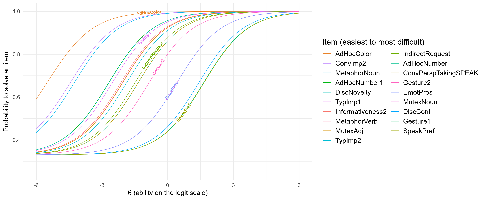
```

### Step 3. Differential item functioning

The last step of item selection involves investigating whether specific items behave differently for specific subgroups of participants, i.e. differential item functioning [DIF, @bürkner2021a; @holland1993]. This procedure consists of estimating the same parameters (here: difficulty) for the considered subgroups and looking at whether the 95% CrIs overlap. We assessed DIF by sex (female and male). In Figure \@ref(fig:val-trr).A shows near identical difficulty estimates for male and female participants. This step therefore did not lead to the exclusion of any items.

## Test-retest reliability

In order to assess whether the final battery is suitable for measuring individual differences, a test - retest reliability study was conducted (link to pre-registration: [<https://aspredicted.org/zr94wp.pdf>] ). 68 children (mean age = 5.32, range: 2.90-6.90) were recruited through local kindergartens in Lüneburg, Germany, and tested two times with a one week distance between the two test points. Because of an error, most of the children (N = 63) were tested on an 18 items version, instead of 19 (the Verb Metaphor item was erroneously excluded during the reprogramming of the final battery version). However, we think this does not substantially influence the interpretation of the results. The Pearson’s correlation between the two test points’ proportion of correct answers was high (r = .70, p \< .001), indicating good reliability (see Figure \@ref(fig:val-trr).B).

## Convergent Validity

Since vocabulary skills have been shown to strongly correlate with pragmatic abilities [@matthews2018; @bohn2019c; @pronina2023], we assessed convergent validity by administering a receptive vocabulary test, the oREV [@bohn2024h]. The oREV consists of a picture selection task where children hear a word and have to select the picture depicting the target word among four options. As PraBat, oREV is a browser-based web application and can be completed online. The children who were contacted via the Leipzig database and had completed PraBat, were therefore contacted again via email and asked to complete the oREV as well. 457 children (mean age = 5.54, range: 3.01-8.04, 220 females) from the original 713-children sample who completed the PraBat, also completed the oREV. The correlation between PraBat and oREV scores was strong (r = .64, p \< .001, see Figure \@ref(fig:val-trr).C), even when controlling for age (r = .30, p \< .001). We take these results to indicate the good validity of the PraBat battery.

```{r val-trr, include = T, echo=FALSE, cache=FALSE, out.width="100%", fig.cap="A. Correlation between the male and female groups’ parameter estimates for difficulty to identify cases of Differential Item Functioning. Points show the mode of the posterior distribution for each item with 95% CrIs. B. Correlation between children’s accuracy proportion in test point 1 and test point 2 in the test re-test reliability study. C. Correlation between the sample’s accuracy proportion in the 19-item version PraBat battery and oREV vocabulary test."}
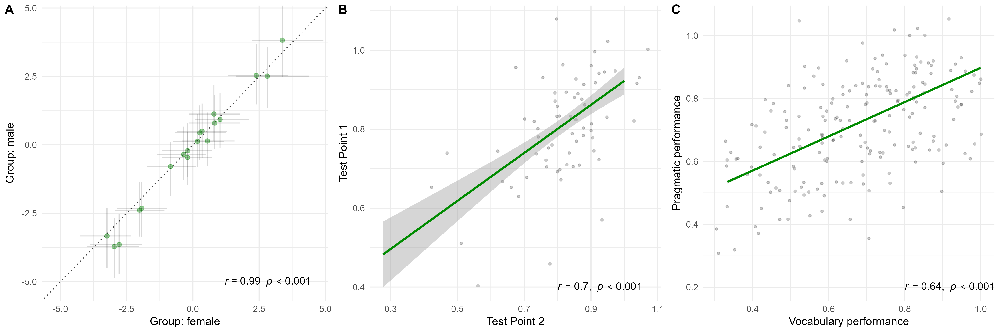
```

## Cross-cultural adaptation

The battery was developed in the context of a broader, cross-cultural project that involves samples from Germany, Türkiye and Kenya. Therefore, we wanted to ensure the battery would be suitable for multiple cultural and linguistic settings and jointly developed the battery for German, Turkish, Kikuyu, and Kiswahili (the latter two being the local and common languages in the testing area in Kenya).

Native speakers of each of the languages were involved in the item creation process and assessed whether each item was suitable for the respective cultural contexts. All verbal prompts were recorded by native speakers of the language. Image and translation adaptations were made when needed to make the items more culturally appropriate, making sure this adaptation would not compromise the nature of the item and the comparability with the original item in the other contexts. For example, if an item contained fruits, local types were chosen so that children would be familiar with them. As far as the linguistic aspects are concerned, changes in translations were made only when they improved the naturalness of the prompts without compromising the cross-linguistic comparability of the relevant pragmatic phenomenon.

Before the major data collection aimed at the item selection process, pilot testing sessions were conducted in Nanyuki, Kenya (N = 18, range: 3-5.5) and Lüneburg, Germany (N = 21, range: 3.1-5.88). In general, children from both samples responded very well and were engaged with the battery. More specifically, piloting in Kenya was conducted in a rural area outside the city center of Nanyuki. Despite being generally less familiar with tablets and digital applications, Kenyan children overall understood the task and completed the battery. Kenya’s linguistic setting is characterized by intense code-switching, and bilingualism is widespread. When reported to be bilingual (N = 16), children were therefore tested in both languages. Figure \@ref(fig:pilot).A shows children’s performance in Kikuyu and Kiswahili on the initial, 27-item long version of the battery. The expected increase in performance with age suggests that the battery is a valid instrument for this context. Minor changes were applied after this data collection to improve the items.

Since establishing the final set of items, the task has been adapted to other contexts; the website hosting the task will thus be continuously updated. At the time of writing, next to the German, Kenyan, and Turkish version, we include a Swiss-German and American-English version. Figure \@ref(fig:pilot).B shows the proportion of correct answers of the Turkish pilot, completed at the current time on the final, 19-item version of the battery.

```{r pilot, include = T, echo=FALSE, cache=FALSE, out.width="80%", fig.cap="Predicted developmental trajectories based on a GLMM model of the Kenyan (A) and Turkish (B) sample's accuracy on the 19 selected items, by age and language. Black points show age group means (with 95% CI based on non-parametric bootstrap). Light dots show the proportion of correct answers for each subject. The dotted line shows the level of performance expected by chance."}
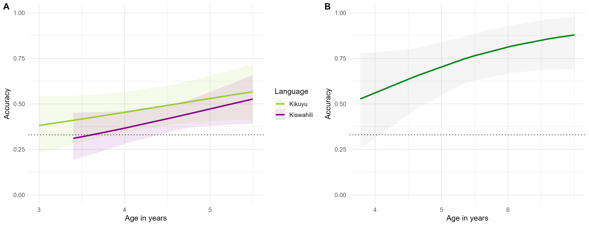
```

# Discussion

In the current study, we presented the development of PraBat, a test battery to assess individual differences in pragmatic abilities in preschool children from different cultural and linguistic backgrounds. We initially compiled a larger item pool of pragmatic tasks based on the literature. We then used Item Response models in combination with a semi-automated selection algorithm, to identify a set of items that best balanced between an overall good fit to the Rasch model and a set size that allows differentiating between individuals. The result is a 19-item battery which displayed good test-retest reliability and convergent validity.

Out of the 27 items in the initial item pool, 8 were excluded. One might wonder what the exclusion of these items means for the questions of which items – and with that which procedures or inferences – should be considered part of the broader concept of pragmatics. The fact that specific items were not included in the final battery does not necessarily negate their pragmatic nature and should be seen in light of how items were selected. The selection was guided by an algorithm that maximized an objective function which balanced between variability in item difficulty, item discrimination, and fit to the Rasch model. Therefore, the reasons for the exclusion of specific tasks are manifold. Some items, for example, had good discrimination and fit, but were very similar in difficulty to other items which had an overall better profile. This was the case for the items Listener conversational perspective taking 1 and 2, and Communicative gesture comprehension 3. Other items were excluded because they showed a poor outfit (Metaphor Adjective) or low discrimination (Conversational Implicature 1, Informativeness 1, see Figure 1 in Supplementary Material). While poor outfit (the only item-level fit issue present in our items, see Figure 2 in Supplementary Material) may indicate too high predictability of the responses and may be due to the high easiness of the items [@linacre2002; @wright1994a; @boone2014], low discrimination values indicate that a specific item does not differentiate well between different sections of the latent ability, but not that the supposedly measured ability is not pragmatic. For example, low discrimination value for Informativeness 1 may have been determined by the heavy load of the task on memory skills, while performance in Conversational Implicature 1 may have been influenced by the ambiguous nature of the prompt sentence. However, other items capturing the same phenomena (Informativeness 2 and Conversational Implicature 2) showed better discrimination estimates, indicating that different versions of the same items, relying less on memory and on less ambiguous sentences, succeeded in differentiating between sections of the latent ability. Scalar Implicature and Verb Mutual Exclusivity on the contrary, were very difficult items that were probably excluded due to their high difficulty compared to the rest of the items, and would not have guaranteed sensitivity to individual differences for higher ability levels: the objective function penalizes item subsets where the deviation of the average easiness distance between adjacent items is high; therefore, subsets including these two items, being very far in difficulty from the rest of the items, were penalized by the objective function.

PraBat has several advantages that make it an important addition to the toolkit for investigating pragmatic abilities. First and foremost, the battery shows very good psychometric qualities, in particular good test-retest reliability and convergent validity. On the practical side, it is implemented as a web app that can be used both remotely and in person. This allows for easy data collection, with no need of manual coding, transcriptions, and trained personnel. The good fit to the Rasch model allows for easy scoring because the sum score serves as a sufficient statistic [@rasch1960]. Moreover, children can complete the final battery in approximately 5 to 10 minutes. These two features address the resource issues that most of the pragmatic assessment tools have, allowing to potentially reach bigger samples needed for individual differences research [@matthews2018].

PraBat's practicality additionally applies to its cultural and linguistic adaptability. The interface was designed to be appropriate for multiple cultural contexts. More importantly, the items have been thought to be suitable for three very different linguistic and cultural contexts (Germany, Türkiye and Kenya) from the start: the included items therefore comprised only phenomena that, for their resolution, require context, speaker, and world information potentially available to children from different cultures and speaking different languages. Therefore, all items can potentially be adapted and translated to a vast range of cultures and languages without major changes.

Despite the benefits of the final battery, there are also several limitations. First, there are important pragmatic phenomena which could not be included, such as, for example, politeness and humor, which highly rely on cultural aspects, other more language-specific phenomena that involve, e.g., reference assignment, interpretation of definite and indefinite articles, determiners and pronouns, intonation patterns marking information structure, pragmatic particles. As already mentioned, these phenomena were excluded to ensure the cross-cultural appropriateness of the battery.

Secondly, we are aware of the fact that, despite careful adaptation and translation, there might be fine-grained pragmatic aspects that can change from one context to another. Apart from the linguistic nuances that might be an inevitable and direct consequence of translation, culture might also have an influence on the priority with which specific kinds of information are being considered when solving an item. Additionally, whether the result of IRT measurement models are valid for other cultural contexts - i.e., if they are invariant - needs to be further investigated [@kachergis]. However, we believe our battery can be appreciated as one of the first committed efforts to minimize the impact of cross-cultural differences on assessment of pragmatic abilities.

Despite these limitations, we still argue that the performance in this battery, be it receptive, applied in interaction with an animated character, and possibly subject to fine-grained cross-linguistic and cross-cultural differences, can be indicative of children's general pragmatic ability.

Nonetheless, future research aiming at untangling the nature of pragmatic abilities could aim at creating more items measuring the excluded abilities as, e.g., scalar implicatures and conversational perspective taking, and verify whether their fit indices and parameters change. For example, we believe the use of the quantifier “einige” (german translation of “some”) might have contributed to the high difficulty of the scalar implicature item. Investigating the fit of a scalar implicature involving another quantifier might reveal whether scalar implicatures per se constitute other forms of meaning enrichment not represented in the pragmatic continuum assessed in this battery [e.g., explicatures, @noveck2007]; whether this difficulty is caused by children’s inability to find lexical alternatives for the - rather infrequent - quantifier “einige” [@barner2010]; or whether scalar implicatures are not an integral part of pragmatic reasoning.

Further research can also aim to broaden the range of pragmatic abilities assessed using the same IRT-based approach. For example, when looking at Figure \@ref(fig:ICC-1PL).B, it can be noticed the battery could use the addition of more difficult items, making up for the still uncovered portions of latent ability (e.g., between Gesture 2 and Emotional Prosody) and therefore improving the individual-differences sensitivity of the battery. Joint effort by researchers from different linguistic and cultural backgrounds could be made in order to create items that measure other excluded abilities, such as, e.g., irony, in a cross-culturally comparable way. Furthermore, innovations in the field of audio transcriptions and large language models (LLMs) could be leveraged to create reliable digital tools that permit to integrate expressive abilities assessment, thus making the assessment context more dialogic. For example, a version of the battery could be created where children are able to converse with the character, Ella, and Ella can react based on the children's replies, which could be automatically transcribed and scored. Although research regarding LLMs' potential role in pragmatic tasks is still at a very early stage, such goals do not seem too unrealistic given the rapid development of these technologies [@lee2024]. On the other hand, future cross-cultural research, can investigate the extent of cross-cultural differences in pragmatic phenomena in order to investigate their comparability.

# Conclusion

In the current paper, we reported on the development of PraBat, a test battery to assess individual differences in pragmatic abilities in young preschool children from different cultural backgrounds. PraBat represents an important step forward in pragmatic research, as it addresses the need of easily administrable tools that can provide high-quality assessment of individual differences. We believe this instrument represents an important tool for any researcher investigating pragmatic abilities and how these relate to other social-cognitive abilities or life experiences.

# References

::: {#refs custom-style="Bibliography"}
:::

# Appendix A

| Acronym | Tool's full name | Citation |
|------------------------|------------------------|------------------------|
| ABaCo | Assessment Battery for Communication | @sacco2008 |
| ADOS | Autism Diagnostic Observation Schedule | @lord2000 |
| APACS | Assessment of Pragmatic Abilities and Cognitive Substrates | @arcara2016 |
| APLSC | Assessment of pragmatic language and social communication | @hyter2012, @hyter2017 |
| APT | Audiovisual Pragmatic Test | @pronina2019 |
| CADeT | Communication Abilities Diagnostic Test | @johnston1990 |
| CASL | Comprehensive Assessment of Spoken Language | @carrow-woolfolke.2017 |
| CCC-2 | Children's Communication Checklist, Version 2 | @bishop2006 |
| CELF-5 | Clinical Evaluation of Language Fundamentals | @wiig2014 |
| N/A | Parent Report Measure for Profiling the Conversational Skills of Preschool Children | @girolametto1997 |
| CSBS-DP | Communication and Symbolic Behavior Scales Developmental Profile | @wetherby2002 |
| ELI | L’avaluació del llenguatge infantil | @saborit2005; |
| ESCS | Early social communication scales | @mundy2003 |
| LUI | Language Use Inventory | @oneill2007 |
| PleaseApp | PleaseApp | @andrés-roqueta2024 |
| PLOS | Pragmatic language observation scale | @newcomer2009 |
| PLSI | Pragmatic language skills inventory | @gilliam2006 |
| POM | Pragmatics Observational Measure | @cordier2014 |
| PP | Pragmatic Protocol | @prutting1987 |
| PPECSC | The pragmatics profile of everyday communication skills in children | @dewart1995 |
| Pragma | Pragma | @loukusa2017 |
| SEE | Social Emotional Evaluation | @wiig2013 |
| SICS | Social Interactive Coding System | @rice1990 |
| SLDT-E | Social Language Development Test Elementary | @bowers2008 |
| SOCI | Systematic Observation of Communicative Interaction | @damico1985; @damico1999 |
| TOPICCAL | Targeted Observation of Pragmatics in Children's Conversations | @adams2011 |
| TOPL-2 | Test of Pragmatic Language - Second Edition | @phelps-terasakid.2007 |
| YiPP | Yale in vivo Pragmatic Protocol | @simmons2014 |

: List of the acronyms of the assessment tools cited in the paper.

# Appendix B

| Dimension | Item Name | Example picture | Description | Reference |
|---------------|---------------|---------------|---------------|---------------|
| Figurative thinking (metaphor comprehension) | MetaphorNoun | 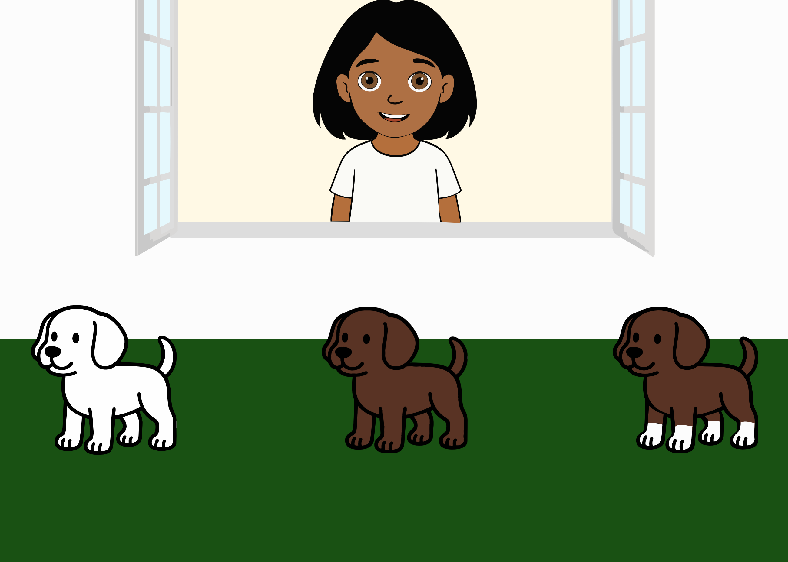 | Ella says: "Oh look, a dog with socks! Which one is it?". The ambiguity of the literal message is integrated with information from the context (the three different dogs, one white, one brown and one having white paws), about the world (socks are worn on the feet) and about the speaker's communicative intention (the utterances Ella would have uttered if she would have wanted to refer to each one of the alternatives). | Based on @pouscoulous2020. |
| Figurative thinking (metaphor comprehension) | MetaphorAdjective | 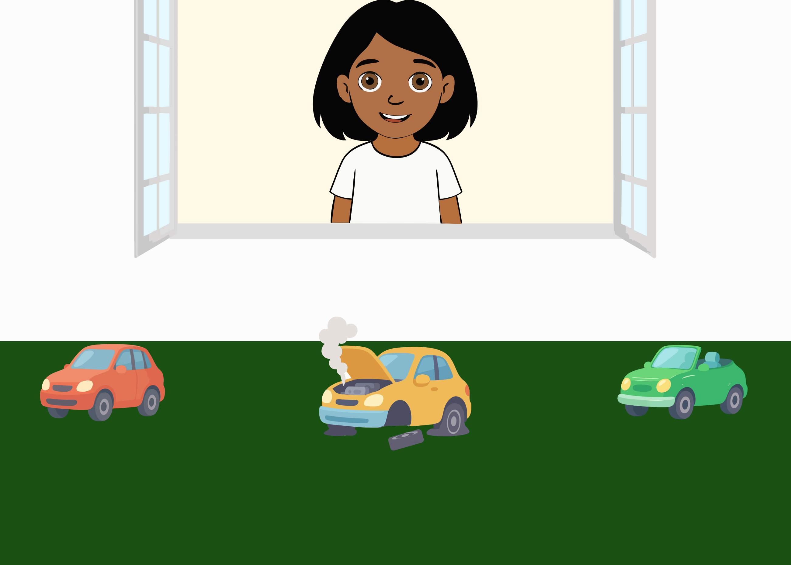 | Ella says: "Oh look, a car is sick! Which one is it?". The ambiguity of the literal message is integrated with information from the context (the three different cars, namely a normal car, a broken one and a convertible one), the world (one who is sick is usually in bad physical conditions) and about the speaker's communicative intention (the utterances Ella would have uttered if she would have wanted to refer to each one of the alternatives). | Based on @pouscoulous2020. |
| Figurative thinking (metaphor comprehension) | MetaphorVerb | 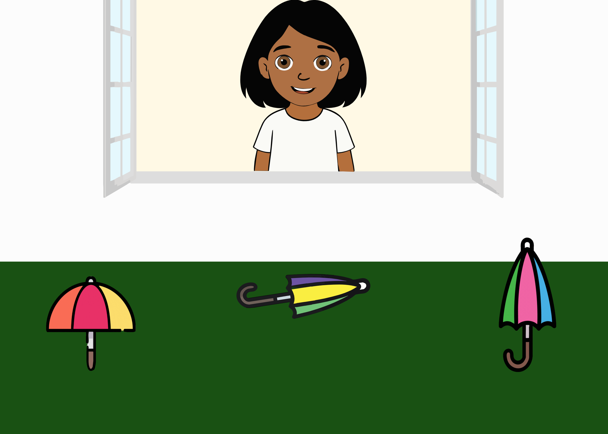 | Ella says: "Look, an umbrella that sleeps! Which one is it?". The ambiguity of the literal message is integrated with information from the context (the three different umbrellas, namely one twirling, one laying on the ground and one opening and closing), the world (one who sleeps is usually laying down) and about the speaker's communicative intention (the utterances Ella would have uttered if she would have wanted to refer to each one of the alternatives). | Based on @pouscoulous2020. |
| Implicature understanding (Conversational Implicature) | ConvImp1 | 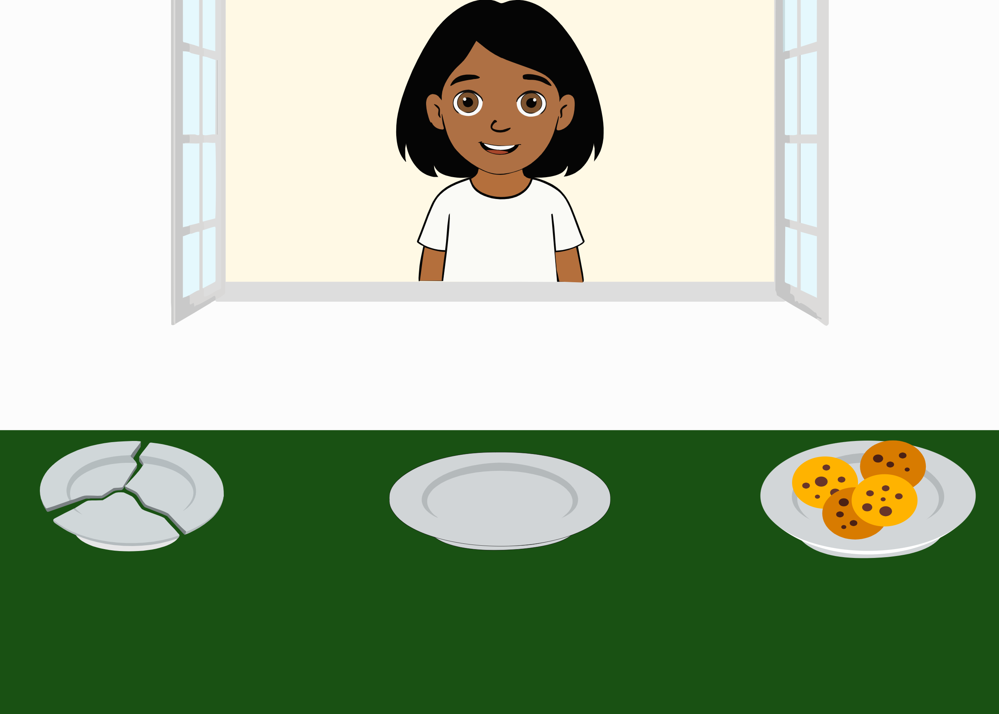 | Ella says: "Now I'm really hungry and I want to eat. Can you give me my plate?". The ambiguity of the literal message (there is no indication as to which one is her plate) is integrated with information from the context (the three different plates, one broken, one empty and one with cookies), about the world (i.e., if one is hungry, they likely want to eat; a broken plate is not useful) and about the speaker's communicative intention (the utterances Ella would have uttered if she would have wanted to refer to each one of the alternatives). | Based on @grice1975. |
| Implicature understanding (Conversational Implicature) | ConvImp2 | 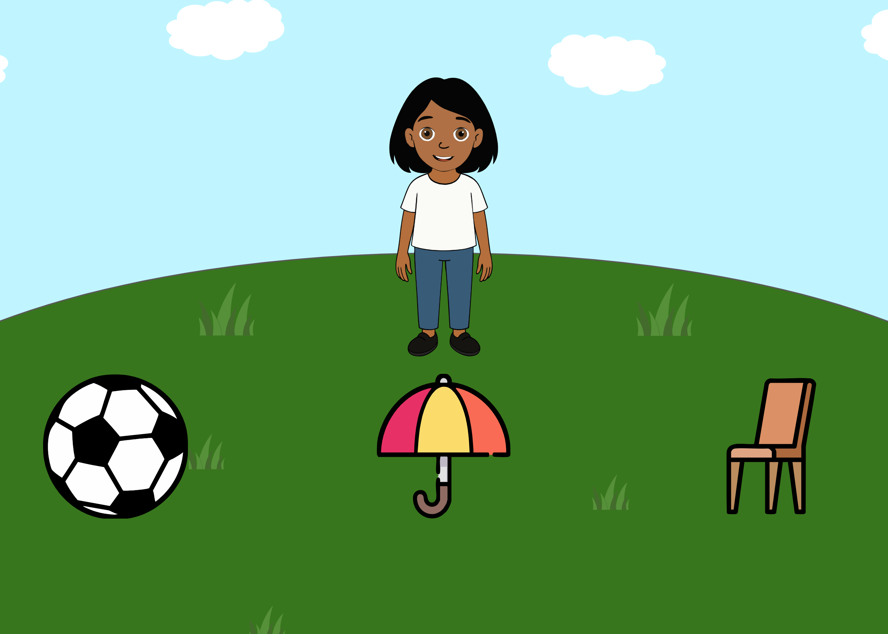 | Ella says: "Oh, it looks like it's about to rain ... Mmh, could you pass it to me?". The ambiguity of the literal message (with a pronoun potentially referring to any alternative) is integrated with information from the context (the three objects) and about the world (the utility of each object in case of rain) and about the speaker's communicative intention (the utterances Ella would have uttered if she would have wanted to refer to each one of the alternatives) | Based on @grice1975. |
| Implicature understanding (Ad-Hoc Implicature) | AdHocColor | 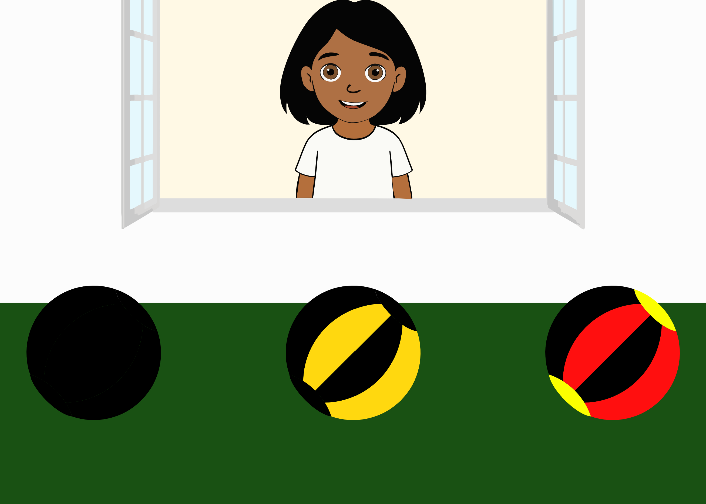 | Ella says: "I want the black ball. Where is it?". The ambiguity of the literal message (the adjective "black" is not false for all three balls) is integrated with information from the context (the three different balls with different degrees of black) and inferences about the speaker's communicative intention (the utterances she would have uttered if she would have wanted to refer to each one of the alternatives). | Based on @bohn2023j. |
| Implicature understanding (Ad-Hoc Implicature) | AdHocNumber1 | 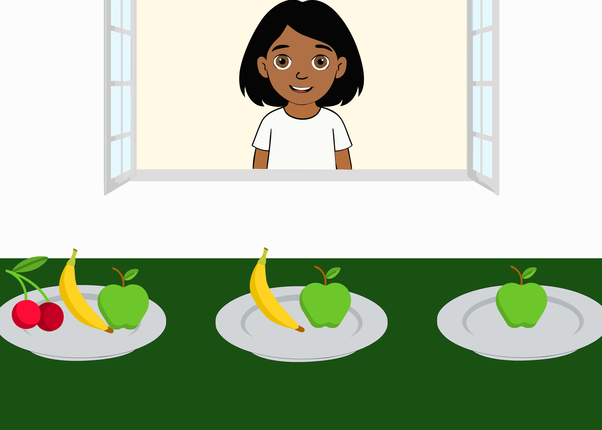 | Ella asks: "Look, the plate with the apple. Can you click on it?". The ambiguity of the literal message is integrated with information from the context (the three different plates, one having fruit and an apple, one an apple and a banana, one only an apple) and inferences about the speaker's communicative intention (the utterances she would have uttered if she would have wanted to refer to each one of the alternatives). | Based on @bohn2023j. |
| Implicature understanding (Ad-Hoc/ Scalar Implicature) | AdHocNumber |  | Ella asks: "There is a plate with a few oranges. Can you click on it?". The ambiguity of the literal message is integrated with information from the context (the three different plates, one containing two oranges, one with fruit and two oranges, one with a lot of oranges) and inferences about the speaker's communicative intention (the utterances she would have uttered if she would have wanted to refer to each one of the alternatives). | Based on @bohn2023j, @grice1975. |
| Implicature understanding (Typicality implicature) | TypImp1 | 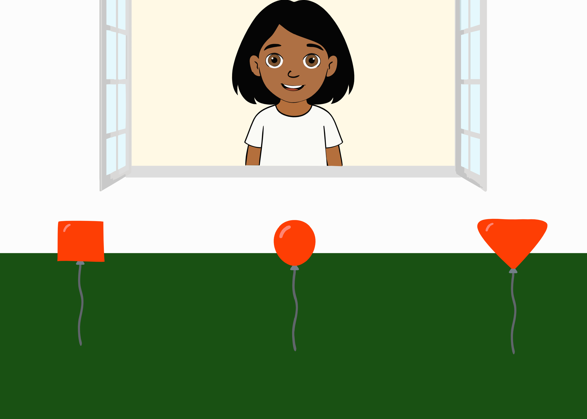 | Ella asks: "Now I need the balloon. Can you find it?". The ambiguity of the literal message is integrated with information from the context (the three different balloons, a typical one, a square-shaped and a triangle-shaped one), about the world (typical balloons are round-shaped) and inferences about the speaker's communicative intention (the utterances she would have uttered if she would have wanted to refer to each one of the alternatives). | [@franchin2023] |
| Implicature understanding (Typicality implicature) | TypImp2 | 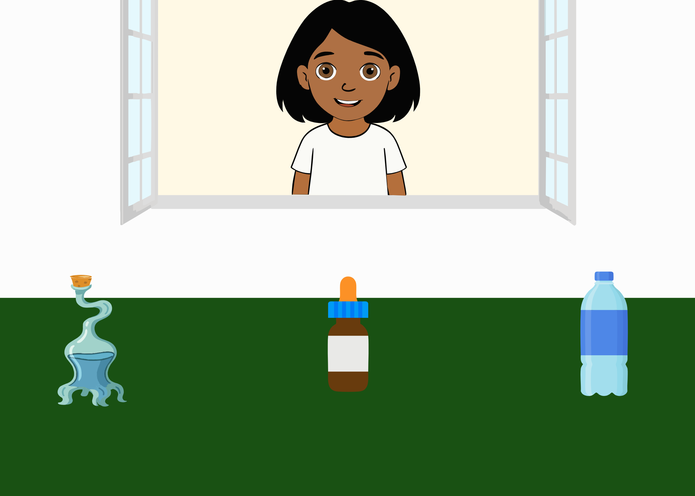 | Ella asks: "Now I need the bottle. Where is it?". The ambiguity of the literal message is integrated with information from the context (the three different bottles, a typical one, a weird one and a medicine bottle), about the world (typical bottles look like the one on the right) and inferences about the speaker's communicative intention (the utterances she would have uttered if she would have wanted to refer to each on of the alternatives). | Based on @franchin2023. |
| Implicature understanding (Scalar implicature) | ScalarImplicature | 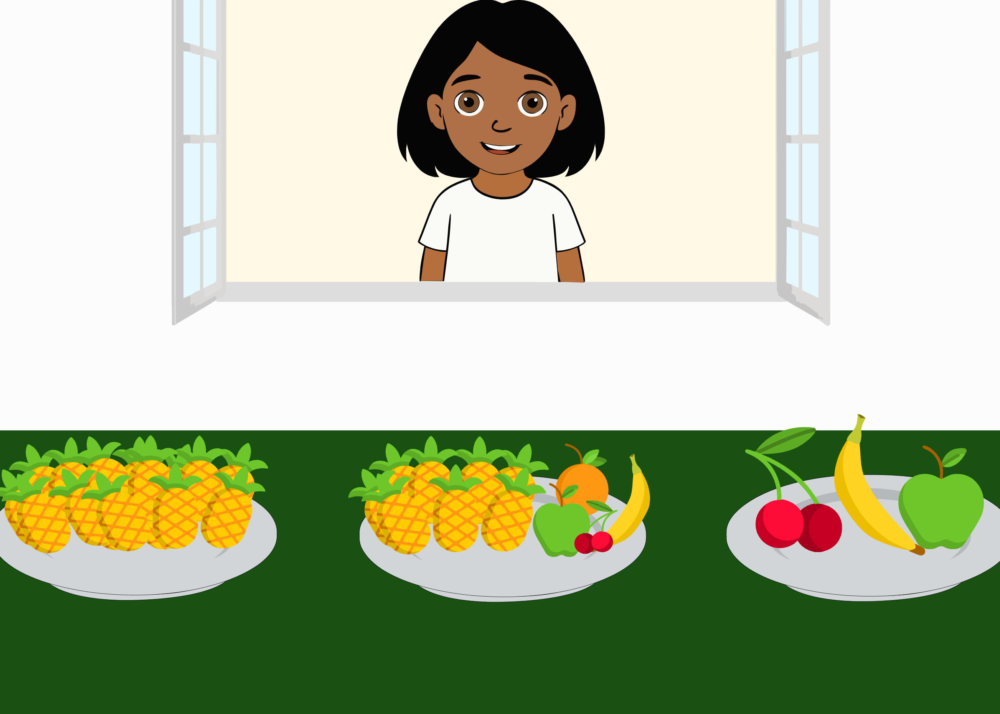 | Ella says: "In my plate some of the fruits are pineapples. Can you click on it?". The ambiguity of the literal message (the quantifier "some" is true for two of the options) is integrated with information from the context (the three different plates, one containing only pineapples, one with fruit and pineapples, one with different fruit) and inferences about the speaker's communicative intention (the utterances she would have uttered if she would have wanted to refer to each one of the alternatives). | [@grice1975] |
| Mutual exclusivity (in nouns) | MutexNoun | 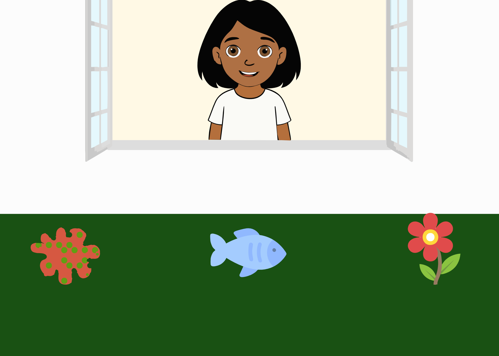 | Ella asks "Look, there's a *palvi*. Can you click on the *palvi*?". The ambiguity of the literal message (where the target word is novel) is integrated with information from the context (the three objects, namely a novel one, a fish and a flower) and inferences about the speaker's communicative intention (the utterances she would have uttered if she would have wanted to refer to each one of the alternatives). | [@markman1988; @bohn2023j] |
| Mutual exclusivity (in adjectives) | MutexAdj | 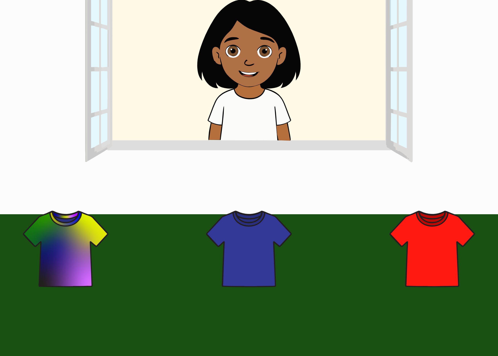 | Ella says: "Now I really want the *sherlig* T-Shirt! Where is it?". The ambiguity of the literal message (where the target word is novel) is integrated with information from the context (the three t-shirts, one with a novel pattern, a red and a blue one) and inferences about the speaker's communicative intention (the utterances she would have uttered if she would have wanted to refer to each one of the alternatives). | Based on @markman1988, @diesendruck2006, @diesendruck2005, @yoshida2013 |
| Mutual exclusivity (in verbs) | MutexVerb | 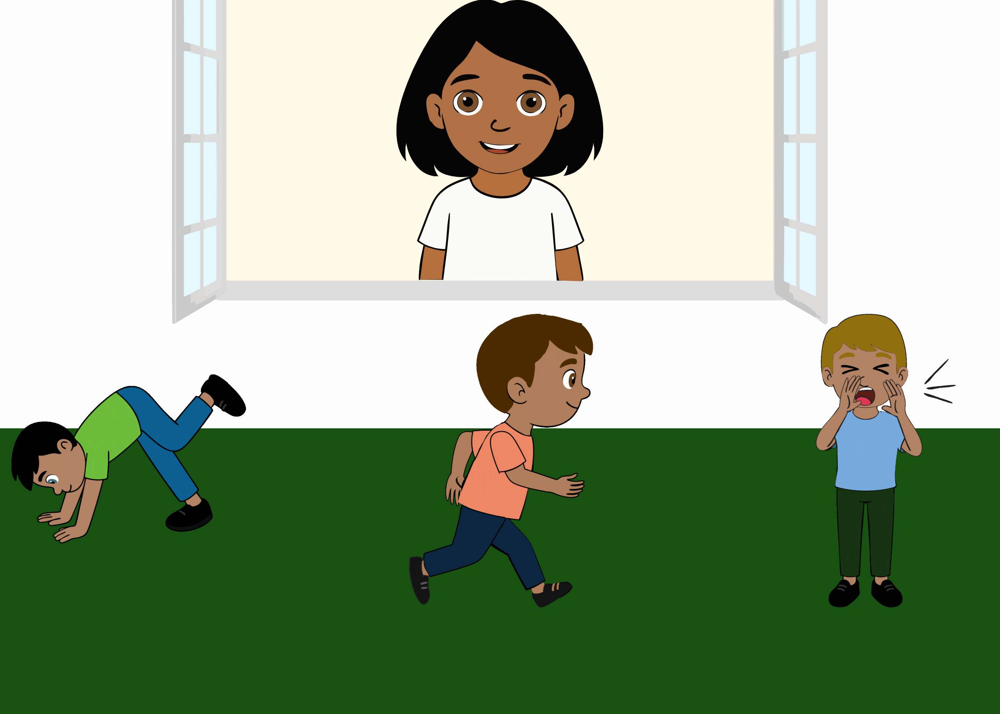 | Ella says: "Oh look! My friend is *warbelling*! Can you tap on him?". The ambiguity of the literal message (where the target word is novel) is integrated with information from the context (the three actions, where the boy either performs a novel action, is running, or is screaming) and inferences about the speaker's communicative intention (the utterances she would have uttered if she would have wanted to refer to each one of the alternatives). | [@markman1988, @merriman1993] |
| Indirect request | IndirectRequest | 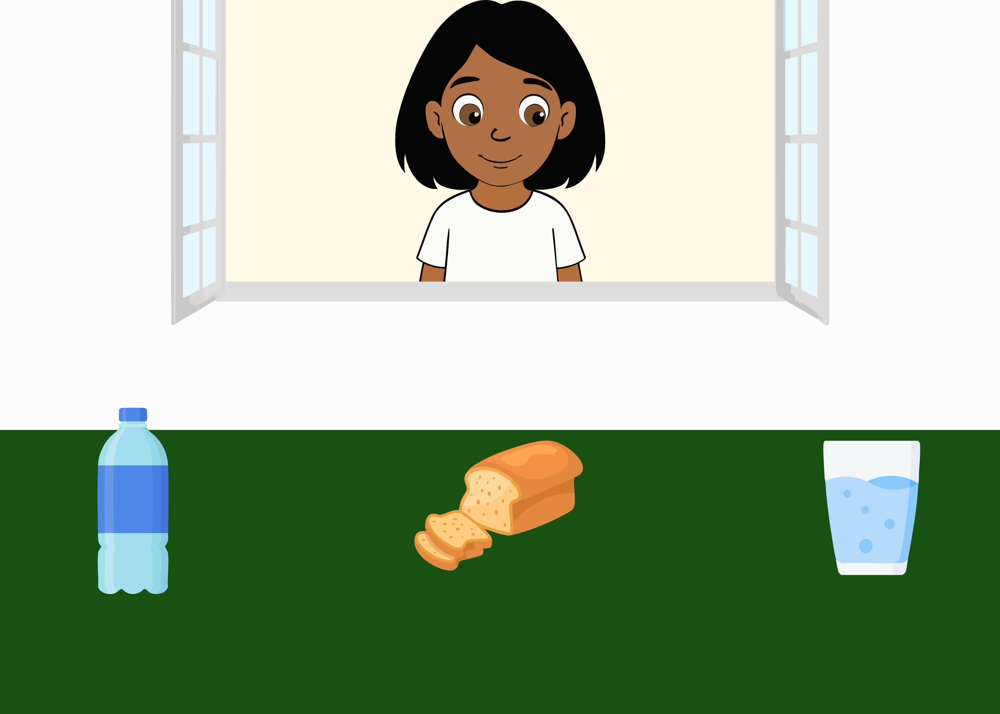 | Ella looks in front of her and says "Mmh, now I'm thirsty..." and looks at the glass of water. The ambiguity of the literal message (where there is no clear request being made) is integrated with information from the context (the three options, namely a bottle, loaf of bread and a glass of water), the world (if one is thirsty, they will likely want to drink) and inferences about the speaker's communicative intention (the utterances she would have uttered if she would have wanted to refer to each one of the alternatives, and the attention of the speaker). | This item was not developed based on a specific paradigm, but builds on literature about indirect requests and integration of gaze cues [@macdonald2013; @nappa2009; @clark1979; @çetinçelik2021]. |
| Discourse-based inferences (Speaker's Informativeness) | Informativeness1 | 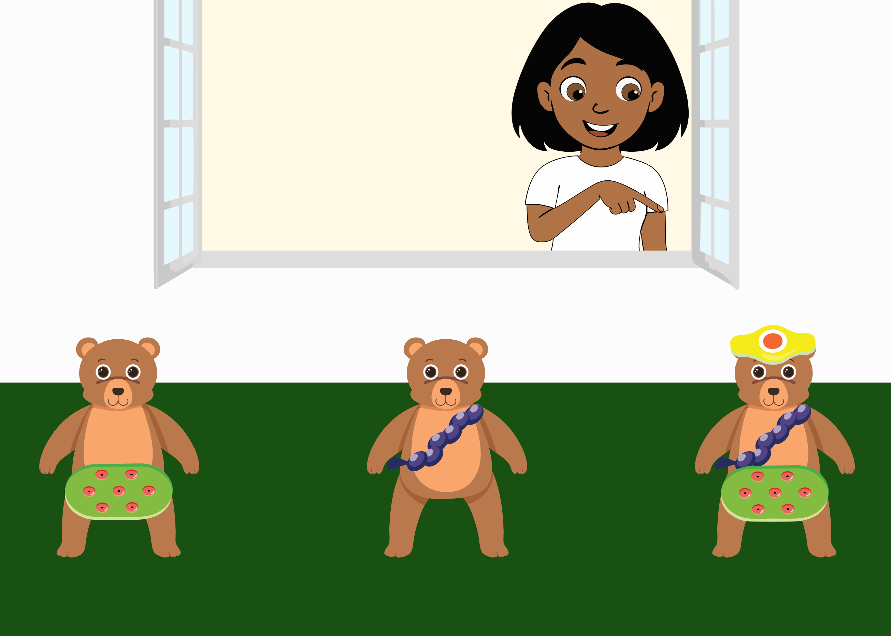 | Ella looks at each one of the three bears: One wearing novel object A, one wearing novel object B and one wearing novel object A, B and C. She does not say anything when looking at the first two, but when looking at the last one (with objects A, B and C), she says "Oh look, a bear with a Sörel! I love the bear with the Sörel!". The scenario changes and three bears appear, each one with only one novel object on them (either A, B or C). Ella asks "Can you click on the bear with the Sörel?". The ambiguity of the literal message (where the target word is novel) is integrated with information from the context (the previous discourse, where Ella only expressed interest when the bear was wearing object C) and inferences about the speaker's communicative intention (the utterances she would have uttered if she would have wanted to refer to each one of the alternatives). | [@bohn2023j] |
| Discourse-based inferences (Speaker's Informativeness) | Informativeness2 | 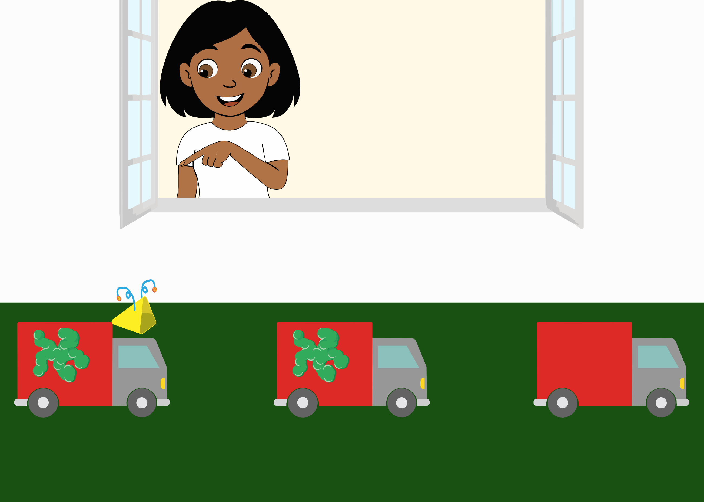 | Ella looks at each one of the three trucks: one with object A and B, one with object B, one without any specific object. She does not say anything when looking at the empty truck and at the truck with object B, but when looking at the truck with objects A and B, she says "Oh look, a truck with a Tikon! I love the truck with the Tikon!". The scenario changes and three trucks appear, each one either with object A, B or no novel object on them. Ella asks "Can you click on the truck with the Tikon?". The ambiguity of the literal message (where the target word is novel) is integrated with information from the context (the previous discourse, where Ella only expressed interest when the truck had object A) and inferences about the speaker's communicative intention (the utterances she would have uttered if she would have wanted to refer to each one of the alternatives). | [@bohn2023j] |
| Discourse-based inferences (Discourse Continuity) | DiscCont | 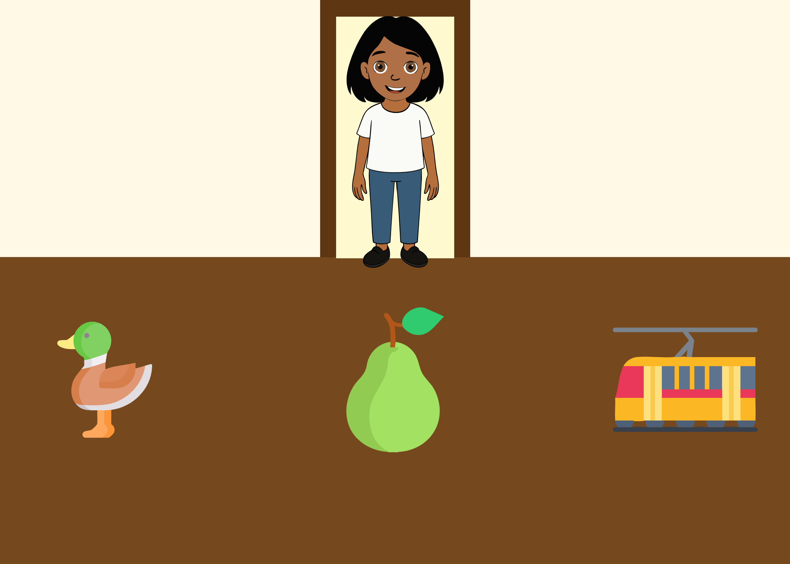 | Ella says she has to collect some things from her room. In five exposure trials, Ella always asks for a different fruit. In the sixth trial, Ella asks "Can you give it to me?". The ambiguity of the pronoun is integrated with information from the context (the previous discourse, where Ella only requested fruit items) and inferences about the speaker's communicative intention (the utterances she would have uttered if she would have wanted to refer to each one of the alternatives). | [@bohn2023j] |
| Discourse-based inferences (Speaker's Preference) | SpeakPref | 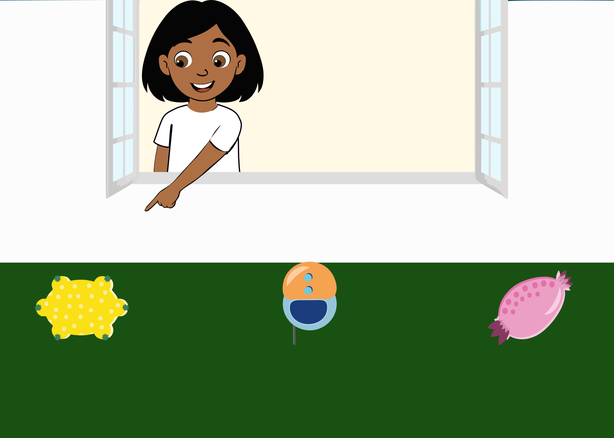 | Ella looks at the first object and affirms: "I really do not like this one!"; She looks at the second and affirms: "This one is fine"; She looks at the third one and affirms: "I really like this one!"; She leaves and when she comes back she enthusiastically says: "Oh the Blivket is still here! Can you click on the Blivket?". The ambiguity of the literal message (containing a novel word) is integrated with information from the context (the previous discourse, where Ella only expressed excitement for the last object) and inferences about the speaker's communicative intention (the utterances she would have uttered if she would have wanted to refer to each one of the alternatives). | [@bohn2023j] |
| Discourse-based inferences (Discourse Novelty) | DiscNovelty | 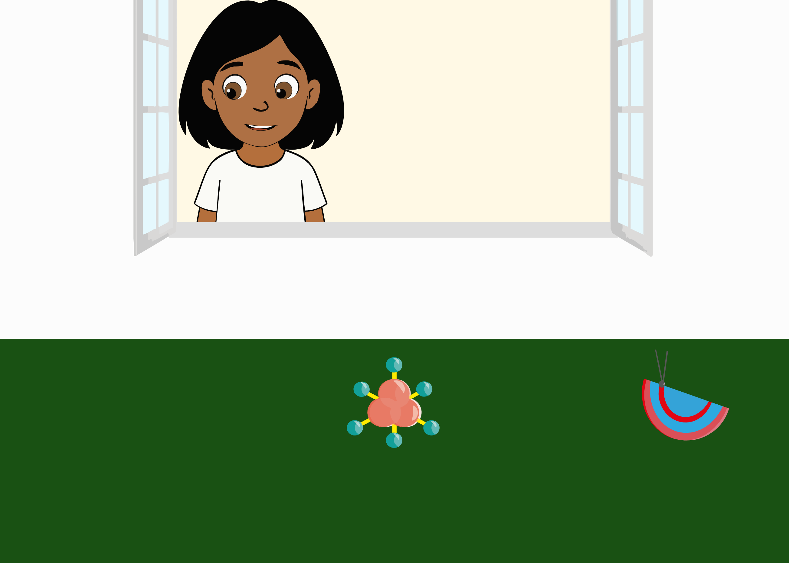 | Ella looks at the first two objects, and, when looking for the third, she finds nothing and says: "Oh, there is nothing here". She leaves; While she is not at the window, a third object appears. Ella comes back and says "Oh, there is a Gepsa! So nice, a Gepsa! Can you give it to me?". The ambiguity of the novel word is integrated with information from the context (the previous discourse, where Ella did not express interest for the first two objects, and noticed the absence of a third one) and inferences about the speaker's communicative intention (the utterances she would have uttered if she would have wanted to refer to each one of the alternatives). | [@bohn2023j; @akhtar1996] |
| Communicative gesture comprehension | Gesture1 | 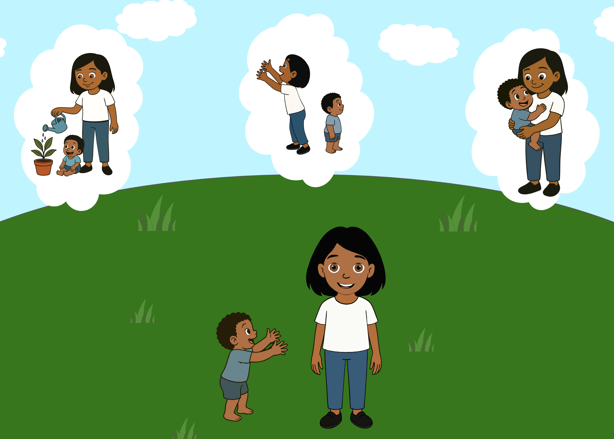 | Ella looks at her brother stretching his arms towards her and asks "What should I do?". The ambiguity of the paralinguistic message (the brother's gesture) is integrated with information from the context (the three alternatives, namely Ella watering a plant, Ella imitating the brother, Ella picking up the brother), about the world (children stretch out their arms when they want to be picked up) and inferences about the speaker's communicative intention (the gestures the brother would have made if he would have wanted Ella to do each one of the alternative actions). | [@bucciarelli2003] |
| Communicative gesture comprehension | Gesture2 | 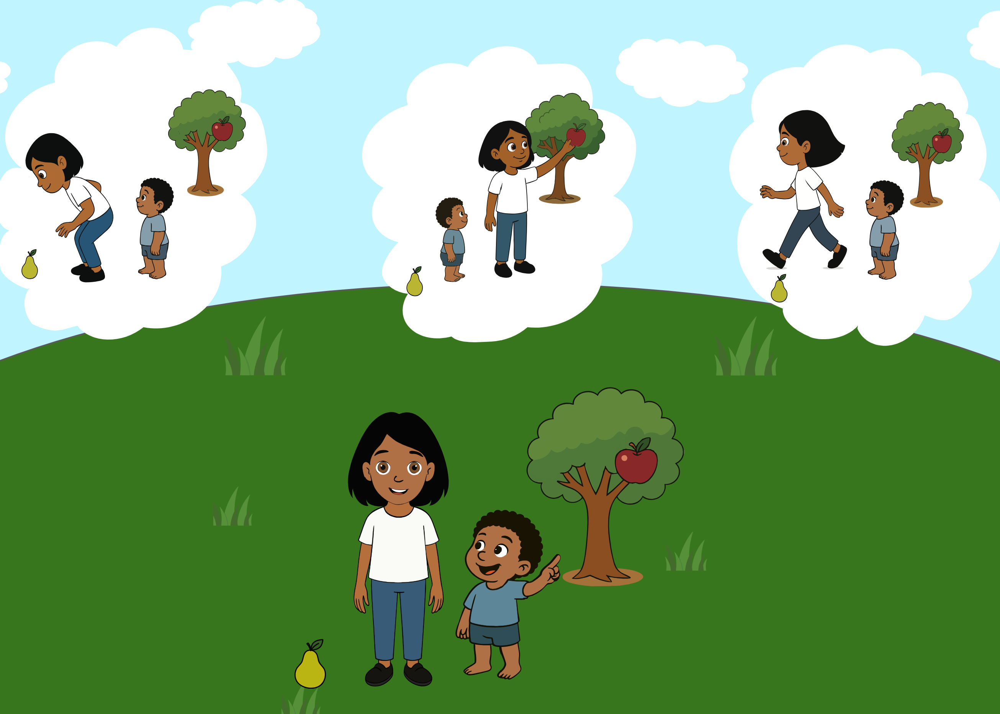 | Ella looks at her brother pointing to the apple on the tree and asks "What should I do?". The ambiguity of the paralinguistic message (the brother's pointing gesture) is integrated with information from the context (the three alternatives, namely Ella picking up the pear from the ground, Ella picking up the apple from the tree, Ella leaving), about the world (pointing directs attention towards something specific) and inferences about the speaker's communicative intention (the gestures the brother would have made if he would have wanted Ella to do each one of the alternative actions, and the brother's gaze). | Based on @bucciarelli2003. |
| Communicative gesture comprehension | Gesture3 | 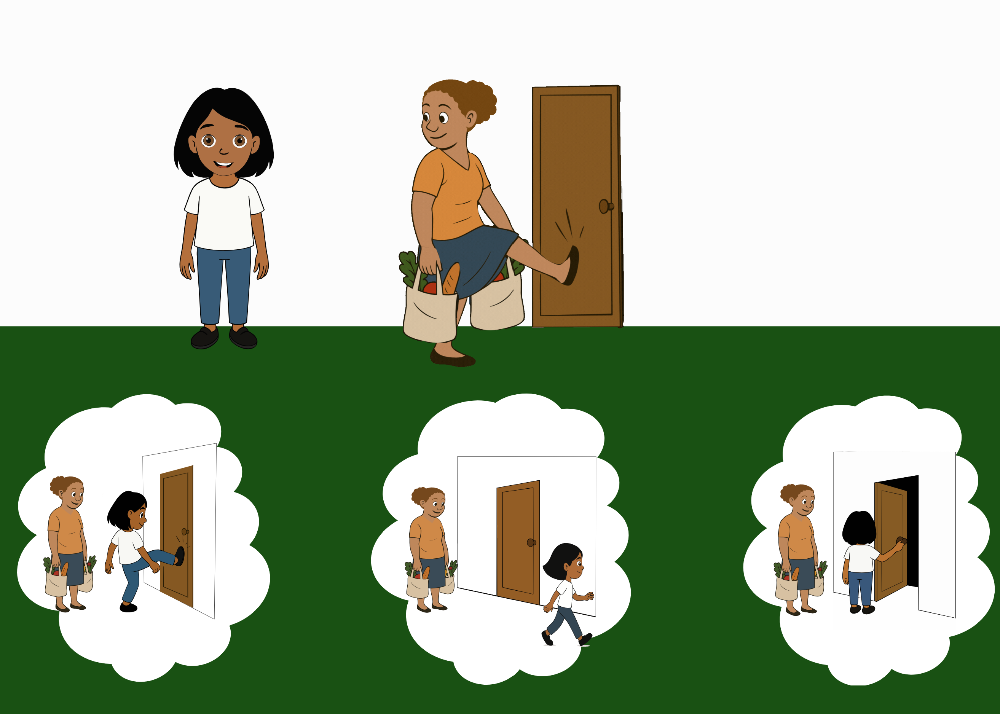 | Ella looks at her mother kicking the door and asks "What should I do?". The ambiguity of the paralinguistic message (the mother kicking the door) is integrated with information from the context (the three alternatives, namely Ella kicking the door, Ella leaving, Ella opening the door), about the world (someone carrying heavy bags cannot open the door) and inferences about the speaker's communicative intention (the gestures the mother would have made if she would have wanted Ella to do each one of the alternative actions, and her gaze towards Ella). | Based on @bucciarelli2003. |
| Emotional prosody understanding | EmotPros | 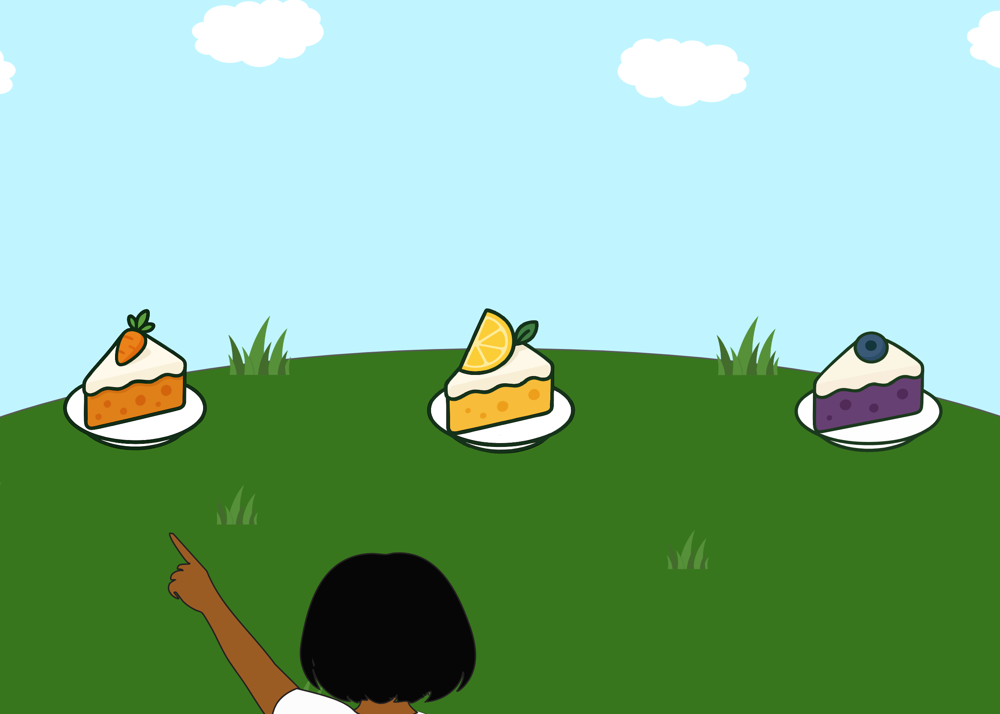 | Ella looks at each piece of cake and says "Oh, cake!". In the first case, she has an enthusiastic intonation; in the second she has a neutral tone; in the third one she sounds disgusted. Then she turns and asks "Which one is my favorite cake?". The ambiguity of the literal message (where no preference for a single cake is expressed) is integrated with information from the context (the three alternatives), about the world (one usually expresses enthusiasm for things they find pleseant) and inferences about the speaker's communicative intention (the intonation Ella would have uttered if she had wanted to refer to a bad, good or normal cake). | Based on @floyd2025. |
| Conversational perspective taking (Listener's perspective) | ConvPerspTakingLIST1 | 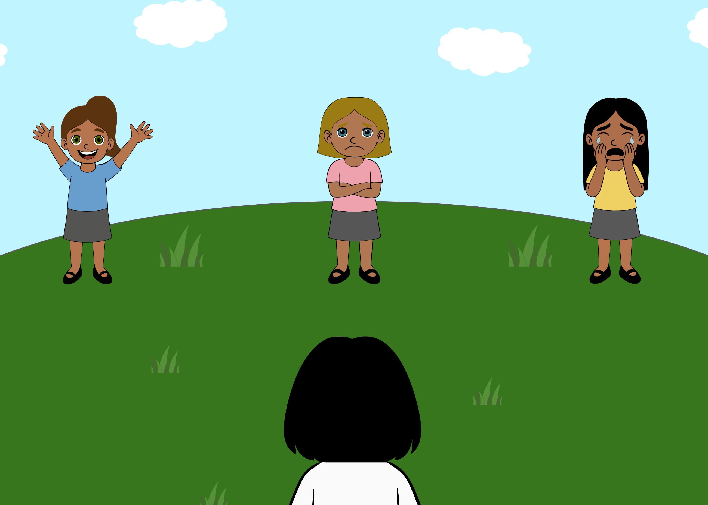 | There are three girls. Ella says: "Anna, I invite you to my birthday party!". One girl becomes happy, one becomes very sad and one starts crying. Then she turns and asks "Can you click on Anna?". The ambiguity of the literal message (there is no indication as to who is Anna) is integrated with information from the context (the three girls, one being happy, one sad and one crying), about the world and about the listener (if one is invited to a birthday party, they might be happy about it rather than sad). | Based on @bernard2007, @lesourn-bissaoui2012. |
| Conversational perspective taking (Listener's perspective) | ConvPerspTakingLIST2 | 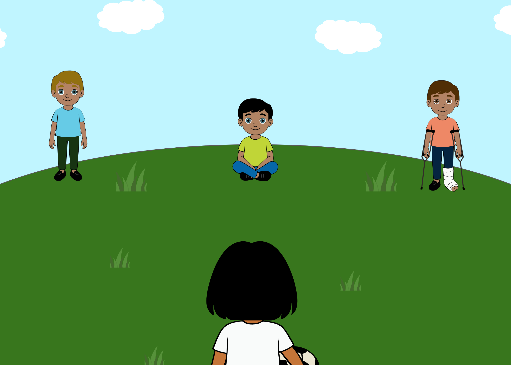 | Ella holds a ball and says: "It's a shame you cannot play with us, Tommi!". Then she turns and asks "Can you click on Tommi?". The ambiguity of the literal message (there is no indication as to who is Tommi) is integrated with information from the context (the three boys, one standing, one sitting and one with a cast on the foot), about the world and about the listener (someone who has a cast, cannot play football; If Ella would have wanted to refer to the other boys, she would have not used the verb "cannot", as none of them is unable to play). | Based on @bernard2007, @lesourn-bissaoui2012. |
| Conversational perspective taking (Speaker's perspective) | ConvPerspTakingSPEAK | 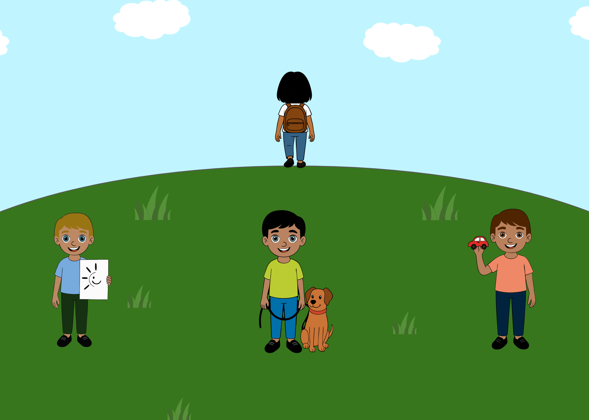 | A voice says: "Ella, can I borrow your pencil?". Ella turns and asks "Who said that?". The ambiguity of the literal message (there is no indication as to who said the sentence) is integrated with information from the context (the three boys, one holding a drawing, one with a dog and one holding a car), about the world (pencils are used on paper) and about the listener (if one needs a pen, they likely want to draw something). | Based on @bernard2007, @lesourn-bissaoui2012. |

List of the items present in the initial, larger, 27-item pool.
